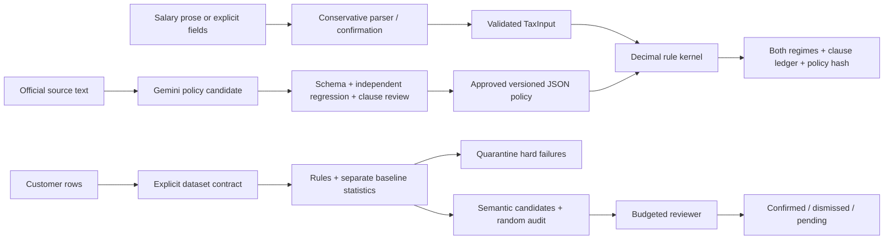

# Architecture

The CLI and HTTP server are thin adapters. Tax models are immutable; computation is pure apart
from loading a policy when one is not supplied. The policy is declarative data, never executable
model output. Rule validation occurs before calculation, and each result identifies the policy hash.

Project B preserves source provenance separately from synthetic injection truth. The same
ground-truth objects score every family but never reach detectors. Hard constraints and uncertain
empirical/semantic findings have different release consequences. Model outages retain pending work.

The shared Gemini adapter owns credentials, pacing, call budgets, timeouts, JSON parsing, usage and
errors. Query-time tax never calls the deterministic engine to repair a wrong model response.
Compilation uses a separate reviewed artifact. Unit-test mocks are never benchmark results.

The generic contract layer has no dependency on the NYC detector. This is deliberate: a new dataset
must state its own schema and domain rules instead of inheriting accidental assumptions. Contracts
are data, so changing column names or an accepted date format requires no source change.

This is a modular monolith. A database, broker or deployment platform would add little to the
assignment. Production scaling would introduce tenant isolation, durable audit records, streaming
windows, authentication and queue/backpressure around semantic reviews; those are documented
design choices, not implemented capacity claims.
